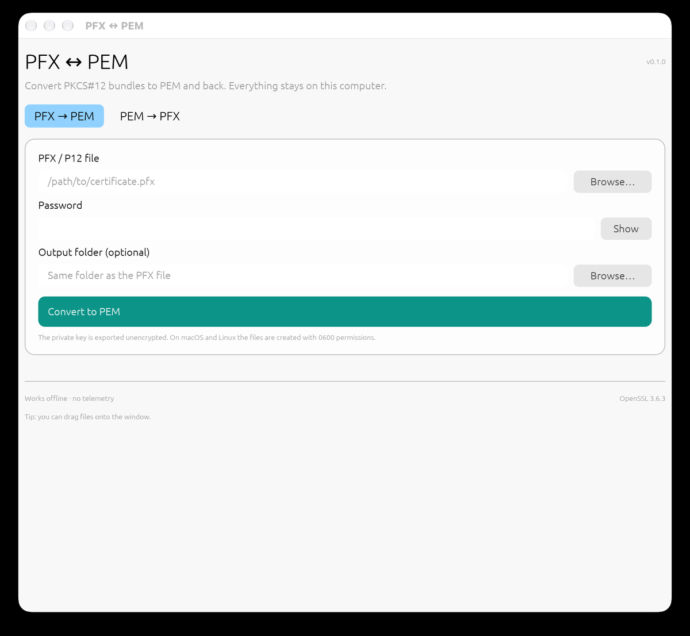

# PFX ↔ PEM Converter

A small, focused desktop application for converting between **PFX/PKCS#12**
(`.pfx`, `.p12`) and **PEM** certificate files.

It runs fully offline, needs no OpenSSL installation, and ships as one portable
executable for **Windows, macOS, and Linux**.



## Features

- **PFX → PEM**: writes the private key, the leaf certificate, and the full
  certificate chain (ordered leaf → intermediate → root).
- **PEM → PFX**: combines an unencrypted private key, a certificate, and an
  optional chain into a password-protected PFX.
- Reads modern AES/PBES2 PFX files *and* old RC2/3DES PFX files.
- Creates PFX files with 3DES/SHA-1 encryption for maximum compatibility with
  Windows, IIS, and older Java keystores.
- Native file dialogs, drag and drop, show/hide password, keyboard-free workflow.
- Never overwrites existing files. Private outputs are created with `0600`
  permissions on macOS and Linux.
- No telemetry, no network access, no background services.

## Download

Grab the latest build from the
[**Releases page**](https://github.com/mcipovic/pfx-pem-converter/releases/latest):

| Platform | Artifact |
|---|---|
| macOS (Apple Silicon) | `pfx-pem-<version>-macos-arm64.zip` |
| macOS (Intel) | `pfx-pem-<version>-macos-x64.zip` |
| Windows 10/11 (x64) | `pfx-pem-<version>-windows-x64.zip` |
| Linux (x64) | `pfx-pem-<version>-linux-x64.tar.gz` |

Every release includes a `SHA256SUMS` file. Development builds from the
`develop` branch are published as a rolling prerelease named **Development
build** (tag `develop-latest`).

### Platform notes

- **macOS:** the app is ad-hoc signed but not notarized. On first launch,
  right-click → **Open**. If macOS says the app is damaged, run:
  `xattr -dr com.apple.quarantine "/Applications/PFX PEM Converter.app"`.
- **Windows:** SmartScreen may warn because the executable is unsigned. Choose
  **More info → Run anyway**.
- **Linux:** extract and run `./pfx-pem`. A normal desktop session with OpenGL
  (X11 or Wayland) is required. The release binary is built on Ubuntu 24.04 and
  needs glibc 2.39 or newer; build from source for older distributions.
- All builds are unsigned. Verify the SHA-256 checksum before running.

## Usage

### PFX → PEM

1. Select a `.pfx` or `.p12` file.
2. Enter its password.
3. Optionally choose an output folder (defaults to the PFX's folder).
4. Click **Convert to PEM**.

For `server.pfx`, the app writes:

| File | Contents |
|---|---|
| `server-private-key.pem` | Unencrypted PKCS#8 private key |
| `server-certificate.pem` | Leaf certificate only |
| `server-fullchain.pem` | Leaf + intermediates + root |

The exported private key is **not encrypted**. Protect the output folder
accordingly.

### PEM → PFX

1. Select the unencrypted private key (PKCS#8, PKCS#1, or SEC1 PEM).
2. Select the leaf certificate (PEM or DER).
3. Optionally select a chain file (PEM or DER, one or more certificates).
4. Enter a PFX password and confirm it.
5. Click **Create PFX**.

Encrypted private keys are not supported directly. Decrypt one first:

```bash
openssl pkey -in encrypted-key.pem -out key.pem
```

Empty PFX passwords are allowed, but the app warns you afterwards.

## Why 3DES/SHA-1 for new PFX files?

PFX is most often consumed by Windows and Java applications. Their support for
modern AES-256/PBES2 PFX encryption varies. 3DES with a SHA-1 MAC is the
widest-compatible password-protected PKCS#12 profile and still requires the
password to open. The private key itself is not weakened by this choice; the
password is the limiting factor. If you need modern PBES2 encryption for a
specific system, use the OpenSSL CLI for that one export.

## Supported formats

- **Reads:** PFX/PKCS#12 with AES/PBES2, 3DES, or legacy RC2 encryption.
- **Writes:** PFX/PKCS#12 with 3DES/SHA-1 encryption.
- **Key types:** RSA, EC (P-256, P-384, …), Ed25519 (tested); other OpenSSL key
  types are passed through.
- **Certificates:** PEM and DER inputs, PEM outputs.
- **Certificate chains:** ordered automatically and de-duplicated.

## Build from source

Requirements: Rust 1.95 or newer, a C compiler, `make`, and Perl (used to build
the bundled OpenSSL). On Windows, the MSVC build tools are required.

```bash
git clone https://github.com/mcipovic/pfx-pem-converter.git
cd pfx-pem-converter
cargo build --release
```

The binary is `target/release/pfx-pem` (`.exe` on Windows). OpenSSL is compiled
from source and linked statically, so the result has no OpenSSL runtime
dependency.

Checks:

```bash
cargo fmt --check
cargo clippy --all-targets -- -D warnings
cargo test
```

Headless smoke test of the packaged binary:

```bash
./target/release/pfx-pem --self-test
```

The self-test exercises both conversion directions and a legacy RC2 PFX.

Packaging scripts for the release artifacts are in [`scripts/`](scripts).
See [`docs/release.md`](docs/release.md) for the full release process.

## Repository layout

```
src/lib.rs        conversion core (OpenSSL, no UI)
src/app.rs        egui desktop interface
src/selftest.rs   headless --self-test
tests/            integration tests and the legacy fixture
scripts/          macOS/Linux/Windows packaging
.github/          CI, build, and release workflows
docs/             release documentation
```

## Security and privacy

- The application contains no networking code and does not contact any server.
- Passwords are only held in memory for the duration of a conversion.
- Existing files are never overwritten.
- On macOS and Linux, all output files are created with mode `0600`.
- The app is not code-signed; releases include SHA-256 checksums.
- Report security issues privately as described in [`SECURITY.md`](SECURITY.md).

## Contributing

The branch model, checks, and release rules are in
[`CONTRIBUTING.md`](CONTRIBUTING.md). `develop` is the default branch; `main`
contains released code.

## License

MIT — see [`LICENSE`](LICENSE). OpenSSL is licensed under Apache-2.0; see
[`THIRD_PARTY.md`](THIRD_PARTY.md) and [`LICENSES/OpenSSL.txt`](LICENSES/OpenSSL.txt).
